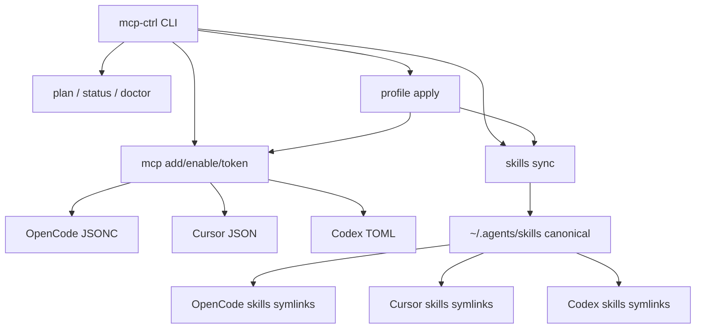

# mcp-ctrl

### **One remote. Three harnesses. Zero secret drift.**

[](https://github.com/anatoly-kulishov/mcp-ctrl/releases)
[](https://www.python.org/)
[](#-quick-start)
[](https://github.com/anatoly-kulishov/mcp-ctrl/pulls)

**Русский** · [GitHub](https://github.com/anatoly-kulishov/mcp-ctrl) · [Releases](https://github.com/anatoly-kulishov/mcp-ctrl/releases)

---

**Универсальный пульт для MCP и skills** across OpenCode, Cursor и Codex.

Разные форматы конфигов (JSONC / JSON / TOML), разное хранение токенов и рассинхрон скиллов — больше не нужно править четыре файла руками.

[Quick Start](#-quick-start) · [Features](#-features) · [CLI](#-cli) · [FAQ](#-faq)

---

## Why mcp-ctrl?

**Проблема.** На одной машине живут несколько AI-coding harness. У каждого:

- свой путь и формат MCP-конфига
- свой способ хранить секреты (inline / `{file:}` / env)
- свой каталог skills (часто через симлинки)

Смена YouTrack-токена = правка в 3 местах. Забыл одно — 401. Cursor **не** подставляет `$VAR` в `mcp.json`.

**Решение.** Один CLI, который:

- показывает матрицу «сервер × harness»
- правит MCP точечно и согласованно
- синкает skills symlink-first из `~/.agents/skills`
- ловит рассинхрон через `plan` / `doctor`
- обновляет токены одной командой с маскировкой в выводе

### Without vs With

| Without mcp-ctrl | With mcp-ctrl |
| :--- | :--- |
| Ручная правка JSONC + JSON + TOML | Одна команда на выбранные harness |
| Токен обновлён не везде → 401 | `token set` пишет OpenCode secret-файл + Cursor/Codex inline |
| Непонятно, что вообще включено | `status` / `plan` / `doctor` |
| Skills разъехались по symlink'ам | `skills sync` (+ `--prune` при необходимости) |
| Онбординг коллеги = часовая инструкция | `./install.sh` → `profile apply default` → `token set` |

### Key benefits

```
🎯  Cross-harness remote   → OpenCode + Cursor + Codex
🔐  Secret-aware tokens    → {file:} / inline, never printed raw
📋  Plan before apply      → mcp-ctrl plan (no writes)
⚡  Safe & prune skills    → add/relink by default; --prune optional
📦  Profiles & catalog     → one-command teammate setup
🐍  Stdlib only            → Python 3.11+, zero npm deps
🔗  Symlink-first skills   → ~/.agents/skills is canonical
```

### How it works



**Идея:** каталог и профили в git (без секретов) → локально `token set` → harness остаются согласованными.

---

## Features

| Feature | Description | Status |
| :------ | :---------- | :----- |
| **Status matrix** | server × harness → active / off / — | ✅ v0.2 |
| **Plan** | MCP + skills diff, без записи | ✅ v0.2 |
| **MCP CRUD** | add / remove / enable / disable по harness | ✅ v0.2 |
| **Token sync** | OpenCode `{file:}` + Cursor/Codex inline | ✅ v0.2 |
| **Skills sync** | symlink-first, safe / `--prune` | ✅ v0.2 |
| **Profiles** | `default`, `frontend` | ✅ v0.2 |
| **Catalog** | MCP-рецепты без секретов | ✅ v0.2 |
| **Doctor** | рассинхрон, битые ссылки, manifest drift | ✅ v0.2 |
| **JSONC-safe edits** | комментарии в `opencode.jsonc` сохраняются | ✅ v0.2 |
| **Backups** | `*.bak-<timestamp>` перед правкой | ✅ v0.2 |
| **Rules sync** | global rules across harnesses | 🔜 later |
| **TUI** | interactive panel | 🔜 later |

---

## Quick Start

### Install

```bash
git clone https://github.com/anatoly-kulishov/mcp-ctrl.git
cd mcp-ctrl
./install.sh

# если нужно:
export PATH="$HOME/.local/bin:$PATH"

mcp-ctrl --version
mcp-ctrl status
```

`install.sh` ставит симлинк `~/.local/bin/mcp-ctrl` и создаёт `~/.config/mcp-ctrl/config.jsonc`.

### First run (teammate)

```bash
mcp-ctrl plan
mcp-ctrl catalog list
mcp-ctrl profile apply default
mcp-ctrl token set youtrack ~/.config/opencode/secrets/youtrack-token
# или: mcp-ctrl token set youtrack 'perm:...'
mcp-ctrl doctor
```

### Everyday

```bash
mcp-ctrl status
mcp-ctrl plan
mcp-ctrl mcp enable figma --harness opencode
mcp-ctrl skills sync              # safe
mcp-ctrl skills sync --prune      # strict mirror of KEEP
mcp-ctrl doctor
```

### Example: `status`

```text
server      opencode  cursor  codex
----------  --------  ------  ------
figma       off       —       active
playwright  active    active  active
youtrack    active    active  active
```

---

## CLI

```bash
mcp-ctrl status [--harness opencode,cursor,codex]
mcp-ctrl list [harness]
mcp-ctrl plan

mcp-ctrl mcp add <name> --from-catalog [--harness ...] [--dry-run]
mcp-ctrl mcp add <name> --type stdio --command "..." [--args ...] [--env K=V]
mcp-ctrl mcp add <name> --type remote --url "..."
mcp-ctrl mcp remove|enable|disable <name> [--harness ...] [--dry-run]

mcp-ctrl token set <server> <value|file> [--harness ...]
mcp-ctrl token source <server>

mcp-ctrl skills list
mcp-ctrl skills sync [--dry-run] [--prune]

mcp-ctrl profile list
mcp-ctrl profile apply <name> [--dry-run] [--prune] [--with-optional]

mcp-ctrl doctor [--fix]
mcp-ctrl catalog list
```

### Workflows

**1. Добавить MCP из каталога**

```bash
mcp-ctrl mcp add youtrack --from-catalog --harness opencode,cursor,codex
mcp-ctrl token set youtrack ~/.config/opencode/secrets/youtrack-token
```

**2. Включить figma только в OpenCode на сессию**

```bash
mcp-ctrl mcp enable figma --harness opencode
# ... работа с макетами ...
mcp-ctrl mcp disable figma --harness opencode
```

**3. Починить skills после ручных правок**

```bash
mcp-ctrl plan
mcp-ctrl skills sync
```

**4. Онбординг с профилем**

```bash
mcp-ctrl profile apply default
mcp-ctrl profile apply frontend --with-optional   # + figma (disabled)
```

> `profile apply <subset> --prune` **откажется** резать полный KEEP — защита от случайного удаления skills.

---

## Configuration

### Paths (what we manage)

| What | OpenCode | Cursor | Codex |
| :--- | :------- | :----- | :---- |
| **MCP config** | `~/.config/opencode/opencode.jsonc` | `~/.cursor/mcp.json` | `~/.codex/config.toml` |
| **Secrets** | `~/.config/opencode/secrets/` via `{file:...}` | inline `env` | inline `[mcp_servers.*.env]` |
| **Skills** | `~/.config/opencode/skills/` → symlinks | `~/.cursor/skills/` → symlinks | `~/.codex/skills/` → symlinks |
| **Canonical skills** | `~/.agents/skills/` | same | same |

### Tool config

`~/.config/mcp-ctrl/config.jsonc` — опциональные overrides:

```jsonc
{
  "paths": {
    // "opencode_config": "~/.config/opencode/opencode.jsonc",
    // "cursor_config": "~/.cursor/mcp.json",
    // "codex_config": "~/.codex/config.toml",
    // "catalog_dir": ""
  },
  "doctor_ignore_servers": ["node_repl"],
  "doctor_optional_servers": ["figma"]
}
```

Пустые / закомментированные ключи = автодетект от `$HOME` / XDG.

### Repo layout (shareable, no secrets)

```text
mcp-ctrl/
  mcp-ctrl.py           # CLI (stdlib only)
  install.sh
  catalog/              # MCP recipes (env key names only)
  profiles/             # default, frontend, …
  skills/manifest.txt   # KEEP list (source of truth)
```

### Catalog entry example

```jsonc
{
  "name": "youtrack",
  "description": "YouTrack issue tracker (local stdio MCP)",
  "type": "stdio",
  "command": "$HOME/youtrack-mcp/.venv/bin/youtrack-mcp",
  "args": [],
  "env_keys": ["YOUTRACK_TOKEN"]
}
```

### Profiles

| Profile | MCP | Skills |
| :------ | :-- | :----- |
| `default` | playwright, youtrack (+ optional figma) | полный `skills/manifest.txt` |
| `frontend` | playwright (+ optional figma) | UI/review subset |

### Enable / disable semantics

| Harness | How disable works |
| :------ | :---------------- |
| OpenCode | native `"enabled": false` |
| Cursor | move entry → `_disabledMcpServers` |
| Codex | move section → `[mcp_servers_disabled.<name>]` |

### Sync modes (skills)

**Safe (default)** — create / relink only, never delete extras:

```bash
mcp-ctrl skills sync
```

**Prune** — ещё и удаляет лишнее в targets (не в `~/.agents/skills`):

```bash
mcp-ctrl skills sync --prune
```

Codex `.system` не трогается.

---

## Safety

- Секреты в любом выводе маскируются (`perm****xx`)
- Файлы с секретами → `chmod 600`
- Перед правкой конфига → backup `<file>.bak-<timestamp>`
- Идемпотентность: нет изменений → нет записи
- `--dry-run` там, где есть side effects
- Manifest `~/.config/mcp-ctrl/manifest.json` хранит **hashes**, не токены
- В git **никогда** не коммитятся secrets / `.env` / `*.bak-*`

**Важно про Cursor:** процесс Cursor не раскрывает `$VAR` / `${VAR}` в `mcp.json`. Для рабочих токенов используй `mcp-ctrl token set` (реальные inline-значения). После правок MCP часто нужен рестарт Cursor.

---

## FAQ

**Чем это отличается от vsync?**  
vsync — отличный общий sync source→targets. mcp-ctrl заточен под наш стек: XDG OpenCode (`~/.config/opencode`), per-skill symlinks из `~/.agents/skills`, и secret-aware `token set` (`{file:}` + Cursor inline без `$VAR`). Идеи plan / safe-prune / manifest / profiles — да, вдохновлены vsync.

**Нужен ли Node/npm?**  
Нет. Только `python3` 3.11+.

**Где лежит source of truth для skills?**  
`~/.agents/skills/` на диске + `skills/manifest.txt` в репо (KEEP). Harness получают симлинки.

**Можно ли коммитить catalog/profiles?**  
Да. Там нет секретов — только имена серверов и env-ключей.

**Что делает `doctor --fix`?**  
Добавляет недостающие MCP с донора-harness и чинит skills sync (safe). Токены сам не угадывает — после фикса: `token set`.

**Ломает ли правки комментарии в `opencode.jsonc`?**  
Точечный JSONC-редактор старается сохранять комментарии и порядок. Всё равно есть backup.

---

## Roadmap

### v0.2 ✅ Current

- [x] MCP status / list / add / remove / enable / disable
- [x] Token set / source across harnesses
- [x] Skills symlink sync (safe + prune)
- [x] Plan, doctor, manifest
- [x] Catalog + profiles
- [x] Public GitHub release

### Next

- [ ] Global rules sync (`~/.agents/rules` → harness)
- [ ] More catalog recipes / team profiles
- [ ] Shell completions
- [ ] Optional TUI (`mcp-ctrl ui`)

---

## Contributing

Issues и PR приветствуются.

1. Fork → branch → PR в `main`
2. Без секретов в коммитах
3. Stdlib only — новые зависимости не добавляем без обсуждения

---

## License

[MIT](LICENSE)

---

**Если инструмент полезен — поставь ⭐ на [репозитории](https://github.com/anatoly-kulishov/mcp-ctrl).**
